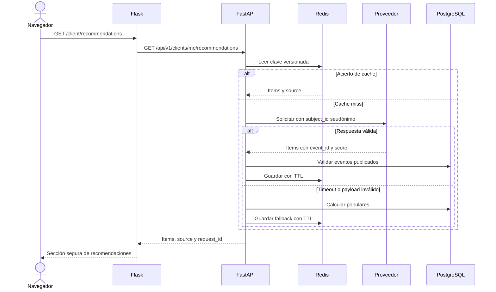
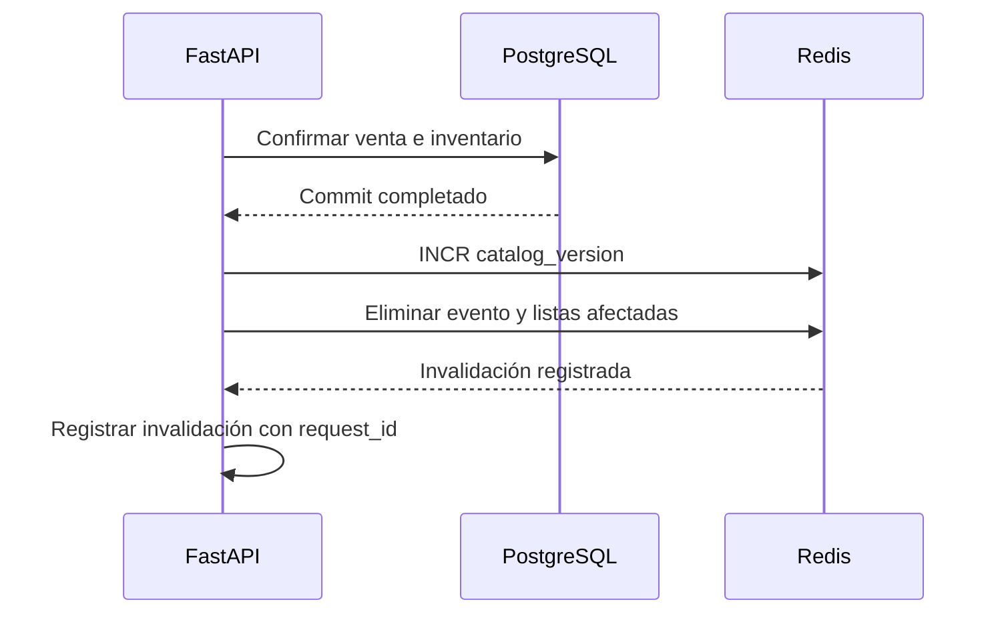
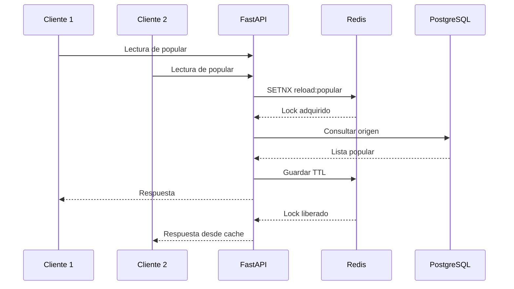

# Design

## Context

La Etapa I (`create-virtual-ticketing-platform`) es el prerrequisito funcional: define usuarios, eventos, zonas, compras, entradas y el contrato web/API, pero todavía no está implementada ni archivada. Esta Etapa II se planifica como una capa de integración sobre ese contrato, sin declarar deltas de capacidades que aún no existen en `openspec/specs/`.

El backend FastAPI es el único que lee datos de dominio y llama al proveedor de recomendaciones. Flask conserva la separación de aplicaciones de la Etapa I y obtiene recomendaciones mediante la API. Redis es una dependencia de infraestructura compartida, no una base de datos de negocio.

## Goals / Non-Goals

**Goals:**

- Entregar recomendaciones solo a clientes autenticados, con contrato de proveedor versionado y fallback popular.
- Reducir lecturas repetidas de PostgreSQL y llamadas al proveedor mediante cache-aside, TTL y versionado de claves.
- Mantener coherencia observable después de publicar, editar, retirar eventos o completar compras.
- Degradar sin impacto visible cuando fallen Redis o el proveedor, y proteger los datos de Etapa I en todos los caminos.
- Mantener las trazas de la Etapa I con `request_id`, hit/miss, invalidación y latencia.

**Non-Goals:**

- No se entrenará ni almacenará un modelo de recomendación propio.
- No se enviarán emails, tokens, pagos, sesiones, códigos QR ni datos personales al proveedor.
- No se cachearán sesiones, respuestas de autenticación, compras, pagos, QR ni disponibilidad usada para confirmar inventario.
- No se añadirá una nueva aplicación ni un worker de fondo; la integración vive en el backend.
- No se implementará publicidad, notificación, check-in ni recomendación en tiempo real.

## Decisions

### Contrato de recomendación propio y adaptador

El backend definirá un contrato interno estable, independiente del proveedor. La ruta de integración será `POST {RECOMMENDATION_PROVIDER_URL}/v1/recommendations` y se autenticará con una credencial de servicio rotable, transportada por HTTPS.

La solicitud tendrá esta forma conceptual:

```json
{
  "subject_id": "hmac-sha256:...",
  "context": {
    "recent_event_ids": ["..."],
    "purchase_count": 3
  },
  "limit": 10
}
```

La respuesta válida será una lista de elementos con `event_id`, `score` y `reason`, más un `generated_at`. Pydantic v2 validará el esquema antes de usar el resultado. El adaptador traduzcirá el contrato a un proveedor concreto cuando se integre; en desarrollo se usará un doble local con el mismo contrato.

**Alternativa considerada:** integrar directamente el SDK o el esquema de un proveedor. Se rechaza porque ata el dominio, las pruebas y el rollback a un producto externo.

### Identidad seudónima y contexto mínimo

El backend calculará `subject_id` como HMAC-SHA256 del identificador interno del cliente con un secreto de entorno. El mismo cliente conservará el valor mientras el secreto no rote. El contexto se limitará a identificadores de eventos comprados recientemente y un conteo; no se enviarán email, nombre, credenciales, tokens, pagos, sesiones ni cargas QR.

Antes de devolver una recomendación, el backend verificará que cada `event_id` exista y esté `published`; descartará duplicados, eventos inexistentes y los que ya no tengan disponibilidad. Esto evita que un contrato externo descuidado exponga eventos fuera del catálogo.

**Alternativa considerada:** enviar el perfil completo del cliente. Se rechaza por privacidad y porque crea dependencia de un esquema de datos personal.

### Fallback local de eventos populares

El cálculo de populares consultará PostgreSQL y ordenará eventos `published` con al menos una unidad disponible por número de entradas vendidas, desempate por fecha de publicación y UUID. El resultado se identificará como `source: fallback` y se almacenará en una clave popular con TTL corto.

Si el proveedor no responde, excede el timeout o devuelve un payload inválido, el adaptador no propagará el error al cliente. El sistema registrará el fallo y usará populares. Si tampoco hay populares, devolverá una lista vacía con estado vacío.

**Alternativa considerada:** devolver un error 5xx al usuario. Se rechaza porque una dependencia externa no debe interrumpir la navegación ni la compra de la Etapa I.

### Redis como cache-aside

FastAPI usará un cliente Redis asíncrono con timeouts cortos y un prefijo de entorno, por ejemplo `tp:stage2:`. Redis no será una fuente de verdad: un `flush` o una pérdida de datos solo provocará misses y lecturas desde PostgreSQL.

Las clases de entrada y valores iniciales serán:

| Clase | Clave conceptual | TTL inicial | Contenido |
| --- | --- | ---: | --- |
| Recomendación | `rec:{catalog_version}:{subject_id}:{limit}` | 300 s | Eventos publicados, puntuación, motivo y origen |
| Populares | `popular:{catalog_version}:{limit}` | 60 s | Lista ordenada de eventos publicados |
| Catálogo | `catalog:{catalog_version}:{page}:{size}` | 60 s | Metadatos públicos de eventos |
| Evento | `event:{catalog_version}:{event_id}` | 120 s | Metadatos públicos de un evento |

Los TTL serán configurables y los valores nunca incluirán sesiones, tokens, pagos, QR ni respuestas de compra. Se aplicará un límite de bytes por entrada y una política de evicción LRU configurable; los nombres de clave versionados permiten cambiar el formato sin invalidar manualmente cada entrada.

**Alternativa considerada:** cache en memoria de cada proceso. Se rechaza porque varias instancias produceían resultados incoherentes y no permitiría invalidación compartida.

### Versionado e invalidación post-commit

El backend mantendrá `catalog_version` como un contador Redis. Las claves de catálogo, populares y recomendaciones incluirán la versión leída al iniciar la lectura. Publicar, editar o retirar un evento, y completar una venta, dispararán la invalidación en el mismo flujo, después del commit de PostgreSQL y nunca antes de confirmar la transacción de negocio.

La invalidación hará `INCR` de `catalog_version` y eliminará la clave del evento cuando corresponda. Si Redis está temporalmente caído, la operación de negocio no fallará: la entrada antigua expira por TTL y la siguiente lectura con Redis disponible usa una versión nueva. Un hook de reconciliación podrá eliminar el prefijo de la etapa al recuperar Redis.

**Alternativa considerada:** invalidar dentro de la transacción de compra. Se rechaza porque una reversión podría dejar la cache invalidada para datos que nunca se confirmararon y complica la consistencia.

### API y web

Se añadirá `GET /api/v1/clients/me/recommendations?limit=10`, disponible solo para `client` activo. La respuesta contendrá `items`, `source` (`personalized` o `fallback`) y metadatos públicos de evento; no devolverá identificadores internos del proveedor ni datos de otros clientes.

Flask añadirá una sección en la vista privada del cliente y un fragmento HTMX para carga asíncrona. La web mostrará estados de carga, vacío, personalizada y fallback sin exponer errores internos ni datos de otros clientes. Los errores de API se mapearán a una lista segura o a la lista popular según el código de degradación.

### Observabilidad

Los hooks de FastAPI conservarán el `request_id` de la Etapa I. Cada operación de cache registrará `hit`, `miss`, `invalidated`, `ttl_expired`, `redis_unavailable` y `stale_version`; el adaptador registrará latencia, código y resultado del proveedor. Los contadores se expondrán mediante un adaptador de métricas ya compatible con la salida de la aplicación, sin enviar datos personales.

Los logs no incluirán cuerpos completos del proveedor, email, `subject_id` en texto claro, tokens, cookies, pagos ni cargas QR. Una prueba de captura de logs verificará la ausencia de esos valores.

## Sequence Diagrams

### Recomendación con cache y fallback



### Invalidación después de una compra



Si Redis falla, la venta permanece confirmada y las entradas expiran por TTL antes de volver a la fuente de verdad.

### Tormenta de misses



## Risks / Trade-offs

- [Proveedor externo lento o caído] → Timeout corto, fallback popular, métrica de degradación y ninguna dependencia en el camino de compra.
- [Cache obsoleta después de un cambio] → Versionado, invalidación post-commit, TTL corto y reconciliación al recuperar Redis.
- [Tormenta de misses] → Lock de recarga con token, espera breve y límite de origen por clave.
- [Pérdida de Redis] → La compra y el dominio siguen usando PostgreSQL; Redis se degrada a miss y se registra.
- [Fuga de preferencias entre clientes] → `subject_id` HMAC, claves versionadas por cliente y pruebas de aislamiento.
- [Popularidad costosa de calcular] → Índice por evento y entradas vendidas, resultado cacheado y TTL corto.
- [Dependencia del secreto HMAC] → Guardarlo fuera del repositorio, rotarlo con versionado de claves y evitar incluirlo en logs.

## Migration Plan

1. Implementar primero la Etapa I hasta tener disponibles el catálogo, la compra, los usuarios y el `request_id`; no desplegar esta etapa sobre un dominio incompleto.
2. Crear la rama `feature/add-recommendations-and-cache` y añadir la configuración de Redis, proveedor, TTL y bandera de la función, sin modificar el esquema PostgreSQL.
3. Levantar Redis en desarrollo y prueba, y verificar sus timeouts con un cliente de prueba antes de conectar la aplicación.
4. Añadir el adaptador de proveedor, su doble de desarrollo y las pruebas de contrato antes de exponer la ruta de API.
5. Añadir el endpoint de recomendaciones, la web Flask y el fallback popular, manteniendo la compra y el catálogo como rutas de lectura directa.
6. Activar primero el modo de observación con la función detrás de la bandera, revisar hit/miss, latencia y degradaciones, y luego habilitar la sección web.
7. Activar invalidación post-commit y ejecutar pruebas de publicación, retiro y compra concurrente en un entorno de staging.
8. Ante un fallo, desactivar la bandera, retirar las rutas, revocar la credencial del proveedor y seguir el `Rollback Plan` de `proposal.md`; Redis puede vaciarse sin migraciones ni pérdida de dominio.
