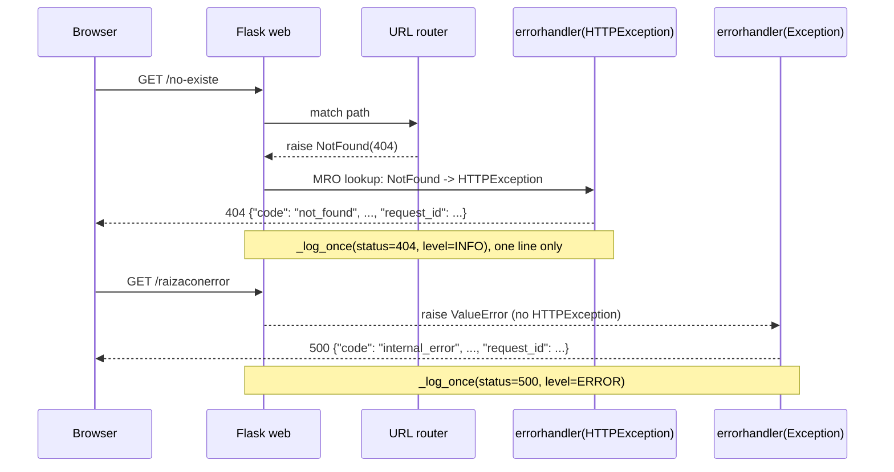

# Design

## Context

`web/ticket_web/observability/middleware.py` registers a generic
`@app.errorhandler(Exception)` that returns a flat JSON body
(`code`, `title`, `status`, `detail`, `request_id`) and logs one access line via
`_log_once`. Flask resolves error handlers by walking the exception's MRO
(`NotFound` → `HTTPException` → `Exception`), so `HTTPException` subclasses fall
into the generic handler and answer `500 internal_error` with an explicit
`status=500` log line. `main.py::_register_error_handlers` already translates
backend API problems and unavailable-backend failures; those paths are unrelated
and keep their `{"error": {...}}` body. See proposal.md for motivation and
`specs/web-frontend/spec.md` for the required behavior.

## Goals / Non-Goals

**Goals:**

- HTTP-level errors (404, 405, other 4xx/5xx from routing) answer with their own
  status and a safe JSON problem body.
- Unexpected failures keep the current `500 internal_error` response.
- The access log records the real status, exactly once per request.

**Non-Goals:**

- HTML error pages or content negotiation (explicitly rejected: JSON body for all
  HTTP errors).
- Changing the body shape of API-problem or backend-unavailable translations.
- Changes to the FastAPI backend, database or dependencies.
- Custom error pages for static assets or user-facing copy/i18n.

## Decisions

1. **Register an `@app.errorhandler(HTTPException)` in
   `observability/middleware.py::register_request_context`, next to the generic
   handler.** It shares `app_name`, `_log_once` and the response-shape helpers
   with the generic handler, so the whole "unhandled local error" family stays in
   one module. Alternative rejected: registering it in
   `main.py::_register_error_handlers` — that module is themed around translating
   backend `problem+json` responses and has no access to the access-log helpers.
   Registration order does not matter: Flask picks the most specific class in the
   MRO (`HTTPException` beats `Exception`).

2. **Handle only HTTP errors (status >= 400); pass 3xx through unchanged.**
   `abort(301/302)` also raises `HTTPException` subclasses; JSON-wrapping them
   would break redirects. The handler returns `exc` itself for `code < 400`,
   which Werkzeug renders as the normal redirect response. Alternative rejected:
   catching every `HTTPException` unconditionally — rejected because it silently
   changes redirect behavior.

3. **Flat JSON body matching the generic handler, not the nested
   `{"error": {...}}` of API problems.** The generic handler's flat shape is the
   established contract for "the web itself failed locally"; the nested shape
   means "a backend problem was translated". Fields: `code` from the Werkzeug
   name (`Not Found` → `not_found`, `Method Not Allowed` →
   `method_not_allowed`), `title` = name, `status` = `exc.code`, `detail` =
   `exc.description` (Werkzeug's safe default text), `request_id` =
   `current_request_id()`, plus the `X-Request-ID` header that
   `after_request` already adds. Alternative rejected: reusing the nested shape —
   rejected to keep "local error" and "translated API error" distinguishable for
   clients and tests.

4. **Log explicitly inside the handler with the real status**, calling
   `_log_once(status=exc.code, level="INFO")` for 4xx and `level="ERROR"` for
   5xx HTTP errors. The `_log_once` guard keeps the subsequent `after_request`
   call from duplicating the line. Alternative rejected: relying only on
   `after_request` — it would log the right status, but the level could not be
   controlled and it would depend on response-processing order.

## Risks / Trade-offs

- [Werkzeug changes its default error descriptions] → clients must rely on
  `code`/`status`, not `detail` wording; tests assert `code` and `status` only.
- [The generic `Exception` handler could swallow HTTP errors again if the new
  handler is removed] → regression test asserting a 404 stays `404` (not `500`)
  guards the MRO behavior.
- [Redirects (`abort(3xx)`) get JSON-wrapped] → decision 2 returns 3xx
  exceptions untouched; add a test if the codebase ever calls `abort()` with a
  redirect.
- [Log volume: 404s now appear as INFO client errors instead of ERROR server
  errors] → this is the correct classification; monitoring that alerted on the
  false 5xx will stop firing, which is the point of the change.

## Migration Plan

- Single-PR change on `feature/fix-web-http-error-handling`; no configuration,
  schema or dependency changes, so deployment is the normal web-app rollout.
- Rollback: revert the merge commit (see proposal.md - Rollback); the previous
  handler behavior is restored without data cleanup.

## Open Questions

- None.
