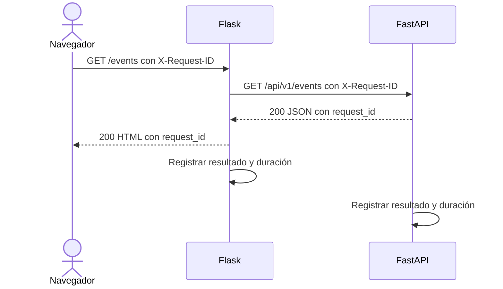
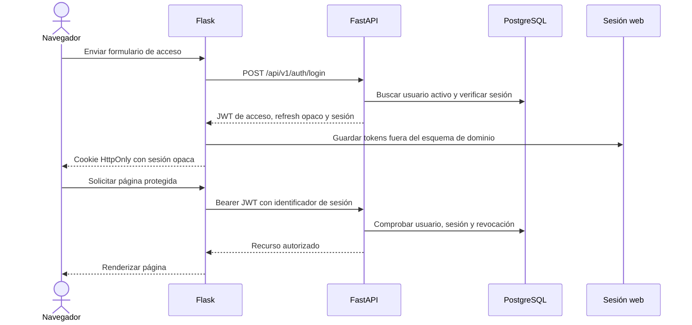
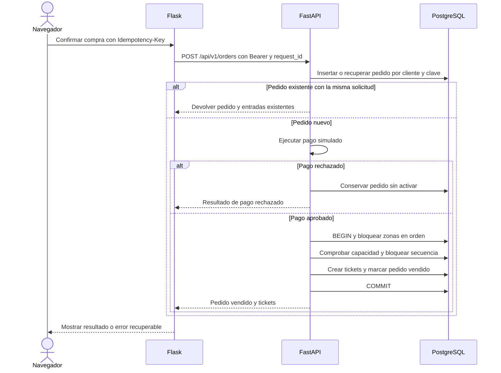

# Design

## Context

El repositorio contiene únicamente intención de producto y no existe una implementación. El cambio debe introducir dos aplicaciones Python separadas: FastAPI para el dominio y Flask 3 con Jinja2 y HTMX para la web. PostgreSQL será la fuente de verdad, Alembic administrará el esquema y pytest verificará backend, frontend e integración. Los requisitos de comportamiento se encuentran en `specs/`.

El navegador no será un cliente de dominio: Flask renderizará HTML y delegará las operaciones en FastAPI. FastAPI será la única aplicación autorizada para leer y escribir datos de dominio. Ambas aplicaciones necesitarán compartir configuración, observabilidad y contratos de error, pero conservarán procesos, despliegue y ciclo de pruebas separados.

## Goals / Non-Goals

**Goals:**

- Mantener una frontera clara entre presentación, API y persistencia.
- Garantizar asignación concurrente sin sobreventa, duplicados ni reutilización de números dentro de una zona.
- Mantener sesiones web seguras y tokens API con expiración, rotación y revocación.
- Proporcionar errores stables para formularios HTML, fragmentos HTMX y clientes API.
- Correlacionar cada salto web/API mediante un identificador de petición.
- Facilitar pruebas aisladas y evolución del esquema mediante migraciones.

**Non-Goals:**

- No se implementará una SPA, un worker externo, cachos distribuidos ni un proveedor real de pagos.
- No se implementará check-in, reembolsos ni validación del contenido QR.
- No se implementará autenticación social ni recuperación de contraseña en este cambio.
- No se compartirán modelos de persistencia entre Flask y FastAPI.

## Decisions

### Aplicaciones y frontera de dominio

Se crearán procesos separados `backend/` y `web/`. Flask usará un cliente HTTP síncrono con agrupación de conexiones para llamar a `/api/v1`; no importará modelos SQLAlchemy ni reglas de dominio. FastAPI expondrá los contratos HTTP y será el único propietario de la base de datos.

Un proxy inverso publicará las rutas web hacia Flask y `/api/v1` hacia FastAPI bajo un mismo origen público. Flask llamará a FastAPI mediante una URL interna. Esta distribución conserva las cookies SameSite, evita CORS para el navegador y no cambia la separación de procesos. La comunicación Flask→FastAPI usará HTTP interno y autenticación de servicio que nunca se exponga al navegador.

**Alternativa considerada:** una SPA y una API únicamente. Se rechaza porque el config exige Flask renderizado en servidor y el diseño necesita mínimo JavaScript con HTMX.

**Alternativa considerada:** hacer que Flask acceda directamente a PostgreSQL. Se rechaza porque duplicaría reglas y permitiría divergir entre interfaz y API.

### Frontend renderizado y sesión web

Flask usará Blueprints, Jinja2 y HTMX para páginas completas y fragmentos. Los formularios se procesarán en el servidor. Las respuestas API con error se transformarán en errores de campo, mensajes flash o fragmentos HTMX, sin exponer excepciones ni respuestas internas.

Flask mantendrá las sesiones en un almacén del lado servidor aislado del esquema de dominio y almacenará allí el token de acceso y el refresh token; el navegador recibirá únicamente un identificador de sesión opaco en una cookie `HttpOnly`, `Secure` y `SameSite`. Cada formulario o petición HTMX que modifique estado incluirá un token CSRF. El cierre de sesión elimina el estado del servidor y revoca la sesión correspondiente en FastAPI.

**Alternativa considerada:** guardar JWT o refresh tokens en `localStorage`. Se rechaza por exposición a scripts de terceros y porque permite acceso sin mecanismo de revocación local.

**Alternativa considerada:** guardar los tokens directamente en cookies firmadas. Se rechaza una cookie firmada con el contenido completo de tokens si el despliegue requiere confidencialidad de esos valores frente al titular de la cookie; se prefiere un identificador opaco.

### Autenticación y autorización

FastAPI validará contraseñas con Argon2id y firmará JWT de corta duración con una clave Ed25519 administrada por entorno. El payload contendrá `sub`, `role`, `sid`, `iat`, `exp` y `jti`, sin datos personales. Cada token se asociará a una sesión persistida; las peticiones protegidas comprobarán que el usuario siga activo y que la sesión no esté revocada, de modo que una suspensión tenga efecto inmediato.

Los refresh tokens serán valores opacos de alta entropía. PostgreSQL almacenará únicamente su hash, fecha de expiración, revocación y relación de rotación. Cada renovación rotará el token y marcará el anterior como reutilizado cuando corresponda. Clientes API directos recibirán los tokens según el contrato de autenticación; Flask los conservará en su sesión de servidor.

Los permisos se comprobarán en dependencias de FastAPI por rol y recurso. `admin` accede a operaciones globales; `event-owner` solo a eventos propios; `client` a sus pedidos y entradas. La interfaz replicará esas restricciones, y la API seguirá siendo la frontera autoritativa.

**Alternativa considerada:** JWT sin estado y sin sesión persistida. Se rechaza porque la suspensión y el cierre de sesión deben invalidar los tokens vigentes.

### Modelo de datos y migraciones

Alembic será la única vía para modificar PostgreSQL. Las entidades principales serán:

- `users`: identificador UUID, email normalizado único, hash Argon2id, rol, estado y marcas de tiempo.
- `auth_sessions`: identificador UUID, usuario, hash del refresh token, expiración, revocación, rotación y familias de sesión.
- `events`: propietario, nombre, descripción, fechas, estado y datos de publicación.
- `zones`: evento, nombre, capacidad y precio decimal no negativo.
- `zone_sequences`: zona y siguiente número; una fila por zona.
- `orders`: cliente, evento, estado, clave de idempotencia, hash de la solicitud y total.
- `tickets`: pedido, zona, propietario, número y datos de la entrada virtual.

Habrá restricciones únicas para normalizar email, identificar cada zona por evento, impedir dos pedidos con la misma clave de idempotencia por cliente y impedir dos tickets con el mismo número en una zona. Los índices cubrirán propietario y estado de eventos, tickets por cliente y sesión por usuario. Las eliminaciones de zonas con tickets se rechazarán en el dominio y mediante una restricción de integridad.

**Alternativa considerada:** calcular el siguiente número con `MAX(number) + 1`. Se rechaza porque dos transacciones concurrentes pueden obtener el mismo valor.

### Idempotencia y concurrencia de ventas

La API exigirá un `Idempotency-Key` por compra. Una restricción única sobre `(client_id, idempotency_key)` resolverá carreras. Si la clave ya existe, la API comparará un hash canónico de la solicitud: si coincide, devolverá el pedido almacenado; si difiere, devolverá conflicto sin modificar datos.

El flujo de pago simulado no llamará una pasarela externa. Primero registrará el pedido; tras la aprobación simulada, una única transacción bloqueará las zonas ordenadas por UUID con `SELECT ... FOR UPDATE`, comprobará capacidad, bloqueará o inicializará `zone_sequences`, asignará números consecutivos y creará todos los tickets. Ante cualquier error se deshará toda la transacción. El orden determinista de zonas reducirá deadlocks cuando un pedido incluya varias zonas.

El estado del pedido y un resultado de venta único se guardarán en la misma transacción que los tickets. No se eliminan tickets ni se reciclan números durante la vigencia de una zona. Si en el futuro existe un proceso externo de pago, deberá añadirse un modelo de compensación o outbox; queda fuera de este cambio.

### Contrato HTTP y errores

FastAPI publicará contratos Pydantic v2 bajo `/api/v1`. Los errores usarán `application/problem+json` con `type`, `title`, `status`, `detail`, `code` y `errors` opcionales. Los códigos de negocio serán estables, por ejemplo `inventory_unavailable`, `idempotency_conflict` y `event_not_publishable`; los mensajes visibles podrán localizarse.

Flask mapeará respuestas 4xx a formularios o mensajes recuperables y 5xx a una página segura de error. Los errores de autenticación eliminarán la sesión local. No se copiarán cuerpos API completos a los logs.

### Observabilidad HTTP

Un middleware de cada aplicación generará un UUID `request_id` cuando falte `X-Request-ID`, conservará uno válido y lo devolverá en la respuesta. Flask propagará el valor a FastAPI. Cada salto registrará una línea JSON con timestamp, aplicación, método, ruta, estado, duración, `request_id` y usuario cuando esté disponible.

Los campos de log se construirán desde una lista permitida. Contraseñas, cookies, bearer tokens, refresh tokens, códigos de pago, cuerpos completos y cargas QR quedarán excluidos. Los registros saldrán por la salida estándar y el despliegue podrá enrutarlos al agregador disponible sin incorporar un SDK de observabilidad.

### Estrategia de pruebas

Pytest tendrá suites separadas para dominio, persistencia, API, Flask e integración:

- pruebas unitarias de autorización, estados, errores e idempotencia;
- pruebas Alembic desde una base PostgreSQL vacía hasta `head`;
- pruebas de API con una sesión de base de datos aislada por prueba;
- pruebas de Flask para renderizado, cookies, CSRF, errores y fragmentos HTMX;
- pruebas de contrato entre el cliente web y los códigos API esperados;
- pruebas de concurrencia con dos transacciones compitiendo por la última entrada disponible.

Las pruebas de extremo a extremo iniciarán Flask y FastAPI contra una base de prueba. Las pruebas de logging verificarán correlación y ausencia de secretos en la salida.

## Sequence Diagrams

### Petición web correlacionada

Los dos registros comparten el mismo `request_id` sin registrar cookies ni cuerpos sensibles.

### Autenticación y renovación web

### Compra concurrente e idempotente

## Risks / Trade-offs

- [Bloqueo de filas por zona] → Bloquear en orden determinista y usar transacciones cortas; vigilar el pool y la contención antes de particionar.
- [Dependencia del almacén de sesiones web] → Aplicar TTL, indexar las limpiezas periódicas e incluirlo en los mismos controles de respaldo que PostgreSQL.
- [Latencia adicional web→API] → Reutilizar conexiones HTTP, evitar flujos con demasiadas renderizaciones y cachear solo lecturas públicas del catálogo.
- [La revocación requiere validar la sesión] → Mantener los JWT de acceso cortos y aislar la consulta de sesión en una dependencia de FastAPI.
- [El contenido QR no realiza check-in] → Usar un nonce opaco y un payload firmado; la verificación se diseñará para una capacidad futura de check-in.
- [El entorno local requiere PostgreSQL] → Ejecutar migraciones y pruebas de concurrencia contra PostgreSQL en lugar de asumir semánticas de SQLite.

## Migration Plan

1. Crear el cambio en `feature/create-virtual-ticketing-platform`; no hacer commits ni push directos a `main`.
2. Crear `backend/` y `web/` como aplicaciones Python independientes con herramientas compartidas de lint, tipado y pytest.
3. Implementar configuración, comprobaciones de salud, logging estructurado y el contrato de errores antes de las rutas de dominio.
4. Crear la revisión inicial de Alembic y aplicarla a una base PostgreSQL descartable.
5. Implementar autenticación y dependencias de roles, después gestión de eventos, y verificar cada capacidad con pytest.
6. Implementar la transacción de compra y ejecutar la suite de concurrencia antes de habilitar la interfaz de compra.
7. Implementar sesiones Flask, CSRF, páginas renderizadas en servidor y fragmentos HTMX sobre el contrato estable de la API.
8. Ejecutar migraciones y pruebas de humo de backend, frontend y extremo a extremo en un entorno de staging.
9. Desplegar FastAPI primero y verificar su health check; después desplegar Flask y comprobar las peticiones correlacionadas.
10. Ante un fallo, detener el tráfico y seguir el `Rollback Plan` de `proposal.md`; no ejecutar reversiones destructivas sobre datos conservados.
